<picture>
  <source media="(prefers-color-scheme: light)" srcset="./assets/hero-light.svg">
  
</picture>

<a href="https://github.com/AadritIND">github ↗</a> &nbsp;·&nbsp; <a href="https://www.linkedin.com/in/aadrit-chandravanci">linkedin ↗</a> &nbsp;·&nbsp; <a href="mailto:aadritchandravanci23@gmail.com">email ↗</a> &nbsp;·&nbsp; <a href="https://aadrit-ind.vercel.app">portfolio ↗</a>

 

I'm Aadrit, a product engineer from India. I work across the stack — interface, API, data, deployment — and I care about how a product feels as much as how it fails.

Most of my favorite work lives where product, infrastructure and security overlap: local-first software, realtime systems, and small tools that remove a little friction from someone's day.

 

### how i work

three modes, one loop.

<picture>
  <source media="(prefers-color-scheme: light)" srcset="./assets/principles-light.svg">
  
</picture>

 

### toolkit

<b>product</b> &nbsp; <code>react</code> <code>typescript</code> <code>vite</code> <code>accessibility</code> 
<b>systems</b> &nbsp; <code>node</code> <code>fastify</code> <code>postgres</code> <code>cloudflare workers</code> <code>d1</code> <code>docker</code> <code>linux</code> 
<b>security</b> &nbsp; <code>threat modeling</code> <code>reverse engineering</code> <code>protocol analysis</code>

 

### elsewhere

more things i've made.

[Aegis](https://github.com/AadritIND/Aegis) · [focusFlow](https://github.com/AadritIND/focusFlow) · [printbridge](https://github.com/AadritIND/printbridge) · [conduit](https://github.com/AadritIND/conduit) · [filemorph](https://github.com/AadritIND/filemorph) · [FormulaVault](https://github.com/AadritIND/FormulaVault) · [prompt-forge](https://github.com/AadritIND/prompt-forge) · [Formula-1](https://github.com/AadritIND/Formula-1)

 

colophon

 

The title card and the process cards are generated SVG with native animation. No trackers or external fonts.

Every piece has a light and a dark version. GitHub picks one with `prefers-color-scheme`; READMEs can't run JavaScript, so the theme switch is automatic.

 

good ideas welcome

<h3><a href="mailto:aadritchandravanci23@gmail.com">say hi ↗</a></h3>

aadrit chandravanci &nbsp;·&nbsp; india &nbsp;·&nbsp; 2026

