

<picture>
  <source media="(prefers-color-scheme: light)" srcset="./assets/hero-light.svg">
  
</picture>

 

  <a href="https://github.com/AadritIND"><b>GITHUB</b></a> &nbsp;·&nbsp;
  <a href="https://www.linkedin.com/in/aadrit-chandravanci"><b>LINKEDIN</b></a> &nbsp;·&nbsp;
  <a href="mailto:aadritchandravanci23@gmail.com"><b>EMAIL</b></a> &nbsp;·&nbsp;
  <a href="https://aadrit-ind.vercel.app"><b>PORTFOLIO</b></a>


 
 

<picture>
  <source media="(prefers-color-scheme: light)" srcset="./assets/seal-ink.png">
  
</picture>

<b>A ONE-PERSON STUDIO</b> &nbsp;·&nbsp; EST. 2025 &nbsp;·&nbsp; INDIA

 

<picture>
  <source media="(prefers-color-scheme: light)" srcset="./assets/act-1-light.svg">
  
</picture>

I'm **Aadrit Chandravanci**, a full-stack engineer from India. I like the whole problem: the interface, the API, the schema, the deploy, the monitoring, and the part where somebody tries to break it.

Most of what I make ends up deployed rather than described — a vault for secrets, a study timer that keeps a room in sync, encrypted rooms for collaboration, a converter that refuses to lose your formatting, a formula library that works with no signal, a print server that turns a browser into a print shop.

I care about the unglamorous parts: fast loads, honest errors, accessible defaults, and data that stays where it belongs. Security is the same instinct from the other side — reverse engineering, protocol analysis, and finding the edge case nobody demoed.

- **Based** — India · UTC+05:30
- **Focus** — Full-stack product engineering, applied AI, offensive security
- **Currently** — **Aegis**, a local-first desktop vault for passwords, API keys and secrets
- **Open to** — Collaborations, hard problems, and good arguments about architecture
- **Elsewhere** — [Portfolio](https://aadrit-ind.vercel.app) · [LinkedIn](https://www.linkedin.com/in/aadrit-chandravanci) · [Email](mailto:aadritchandravanci23@gmail.com)

 

<picture>
  <source media="(prefers-color-scheme: light)" srcset="./assets/act-2-light.svg">
  
</picture>

Six products, built end to end. Not concepts, not screenshots of someone else's template — interfaces, APIs, data models, deploys, and the unglamorous edge cases that decide whether a thing actually works.

<table>
<tr>
<td width="50%" valign="top" align="center">

<a href="https://github.com/AadritIND/Aegis">
  <picture>
    <source media="(prefers-color-scheme: light)" srcset="./assets/poster-aegis-light.svg">
    
  </picture>
</a>

<a href="https://github.com/AadritIND/Aegis">repo</a> &nbsp;·&nbsp; local-first

</td>
<td width="50%" valign="top" align="center">

<a href="https://github.com/AadritIND/focusFlow">
  <picture>
    <source media="(prefers-color-scheme: light)" srcset="./assets/poster-focusflow-light.svg">
    
  </picture>
</a>

<a href="https://github.com/AadritIND/focusFlow">repo</a> &nbsp;·&nbsp; <a href="https://focussf.vercel.app">live</a>

</td>
</tr>
<tr>
<td width="50%" valign="top" align="center">

<a href="https://github.com/AadritIND/conduit">
  <picture>
    <source media="(prefers-color-scheme: light)" srcset="./assets/poster-conduit-light.svg">
    
  </picture>
</a>

<a href="https://github.com/AadritIND/conduit">repo</a> &nbsp;·&nbsp; <a href="https://conduit-liard.vercel.app">live</a>

</td>
<td width="50%" valign="top" align="center">

<a href="https://github.com/AadritIND/filemorph">
  <picture>
    <source media="(prefers-color-scheme: light)" srcset="./assets/poster-filemorph-light.svg">
    
  </picture>
</a>

<a href="https://github.com/AadritIND/filemorph">repo</a> &nbsp;·&nbsp; <a href="https://filemorph-dusky.vercel.app">live</a>

</td>
</tr>
<tr>
<td width="50%" valign="top" align="center">

<a href="https://github.com/AadritIND/FormulaVault">
  <picture>
    <source media="(prefers-color-scheme: light)" srcset="./assets/poster-formulavault-light.svg">
    
  </picture>
</a>

<a href="https://github.com/AadritIND/FormulaVault">repo</a> &nbsp;·&nbsp; <a href="https://formulav.vercel.app">live</a>

</td>
<td width="50%" valign="top" align="center">

<a href="https://github.com/AadritIND/printbridge">
  <picture>
    <source media="(prefers-color-scheme: light)" srcset="./assets/poster-printbridge-light.svg">
    
  </picture>
</a>

<a href="https://github.com/AadritIND/printbridge">repo</a> &nbsp;·&nbsp; <a href="https://print-pi-three.vercel.app">live</a>

</td>
</tr>
</table>

Five of the six above have public demos. **Aegis** is local-first by design.

<b>ALSO IN THE REEL</b>

- [**prompt-forge**](https://github.com/AadritIND/prompt-forge) — describe the task, get the prompt that actually works. Five AI backends, one clean interface. ([live](https://prompt-forge-beige-ten.vercel.app))
- [**Formula-1**](https://github.com/AadritIND/Formula-1) — APEX, a multi-backend Formula 1 fan site built for race weekends. ([live](https://formularace.vercel.app))
- [**Portfolio**](https://github.com/AadritIND/Portfolio) — the other front door: aadrit-ind.vercel.app. ([live](https://aadrit-ind.vercel.app))

 

<picture>
  <source media="(prefers-color-scheme: light)" srcset="./assets/act-3-light.svg">
  
</picture>

The short version: TypeScript and Python, React on the front, Node and Fastify with Postgres or Cloudflare Workers and D1 behind, Docker and Linux underneath — and an unreasonable amount of curiosity applied to the parts that do not fit.

> Interfaces should feel inevitable. Infrastructure should feel invisible. Security should feel boring.

 

<picture>
  <source media="(prefers-color-scheme: light)" srcset="./assets/credits-light.svg">
  
</picture>

 

<picture>
  <source media="(prefers-color-scheme: light)" srcset="./assets/act-4-light.svg">
  
</picture>

These are not vanity metrics. They are pulled from the GitHub API at build time and baked into the artwork — commits across every public repo, live builds you can click, and a year of activity drawn as a film strip.

 

<picture>
  <source media="(prefers-color-scheme: light)" srcset="./assets/numbers-light.svg">
  
</picture>

 

<picture>
  <source media="(prefers-color-scheme: light)" srcset="./assets/footage-light.svg">
  
</picture>

 

<b>How this page is made</b>

 

Every frame is generated SVG: no JavaScript, no external fonts, no tracking pixels. The type is system Helvetica, Georgia and your own mono font; the grain is `feTurbulence`; the light is a few gradients and a lot of restraint.

Dark and light variants switch with `prefers-color-scheme`. The dragon seal is derived from `logo.jpg` and keyed to transparency. The build reads the GitHub API through the `gh` CLI, caches it in `data/cache.json`, and writes every asset with `node scripts/build.mjs`. `node scripts/probe.mjs` then parses the result in a real browser and checks for overflow, dangling references and broken animation timing.

The numbers are regenerated from real data. The cut changes as the work does.

 

<b>OPEN TO COLLABORATIONS · HARD PROBLEMS · WORK THAT SHIPS</b>

 
 

<a href="https://github.com/AadritIND">GitHub</a> &nbsp;·&nbsp;
<a href="https://www.linkedin.com/in/aadrit-chandravanci">LinkedIn</a> &nbsp;·&nbsp;
<a href="mailto:aadritchandravanci23@gmail.com">Email</a> &nbsp;·&nbsp;
<a href="https://aadrit-ind.vercel.app">Portfolio</a>

 

<picture>
  <source media="(prefers-color-scheme: light)" srcset="./assets/footer-light.svg">
  
</picture>
